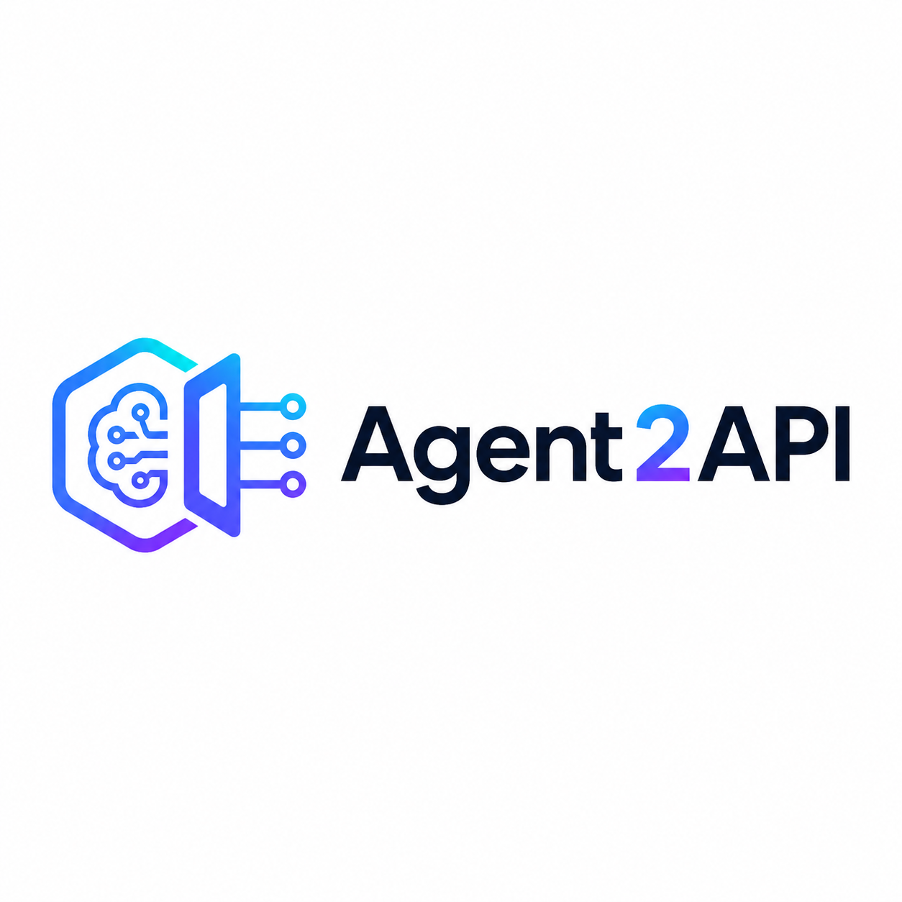
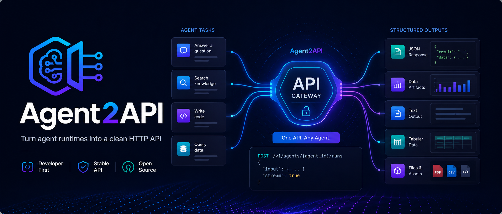
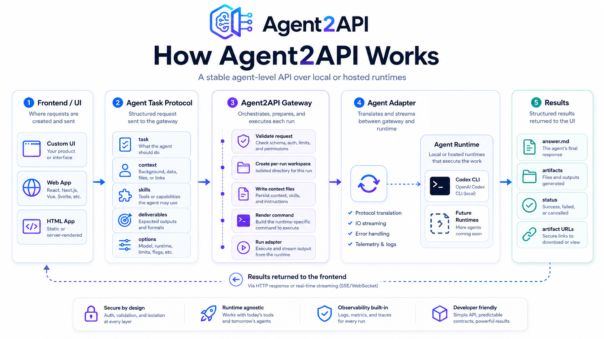
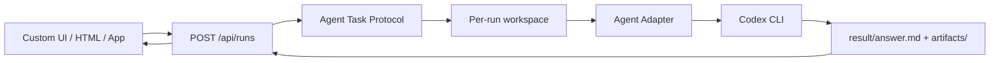
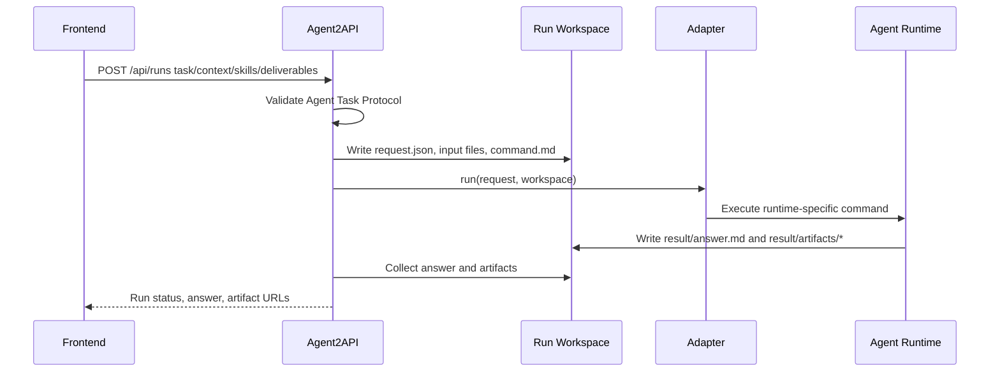
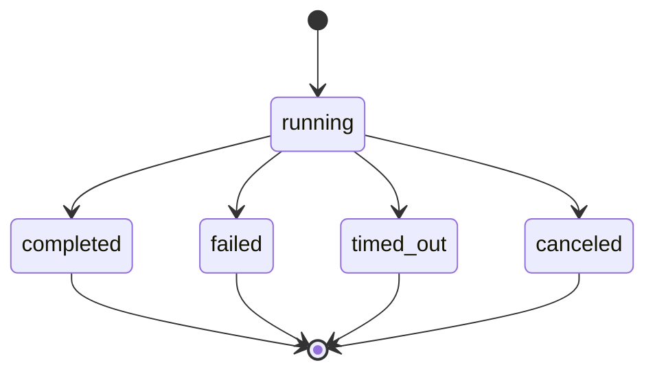

# Agent2API

<div align="center">
  
  <p><strong>Agent2API turns agent runtimes into a clean HTTP API.</strong></p>
  <p>
    Build your own UI once, then run it against Codex CLI today and other agent runtimes tomorrow.
  </p>
  <p>
    <a href="#quick-start"><strong>Quick Start</strong></a>
    |
    <a href="#usage"><strong>Usage</strong></a>
    |
    <a href="#feature-support-matrix"><strong>Support Matrix</strong></a>
    |
    <a href="docs/protocol.md"><strong>Protocol</strong></a>
    |
    <a href="docs/api.md"><strong>API Docs</strong></a>
    |
    <a href="#contributing"><strong>Contributing</strong></a>
  </p>
  <p>
    
    
    
    
  </p>
</div>

<p align="center">
  
</p>

## Summary

Agent2API is a developer-first HTTP layer for running agent work from any frontend, local app, or automation. It accepts a stable task contract, prepares an isolated workspace, calls an agent runtime through an adapter, and returns a structured answer plus artifact metadata.

The public API is intentionally agent-level:

| Field | Meaning |
| --- | --- |
| `task` | What the agent should accomplish. |
| `context` | Files, URL references, and notes supplied by the caller. |
| `skills` | Requested workflows or capabilities, not LLM function calls. |
| `deliverables` | Expected files under `result/artifacts/`. |
| `options` | Execution controls such as sync/async, timeout, sandbox, and web search. |

The first adapter is `codex-cli`. The protocol does not expose LLM messages, function calling, temperature, token budgets, or provider-specific tool schemas. Those details stay behind adapters.

## Motivation

Most AI APIs are model-level: they expose messages, tokens, tools, sampling options, and provider-specific response shapes. That is the wrong abstraction for a product UI that wants an agent to complete work.

Agent2API draws a clean boundary:

| Frontend owns | Agent2API owns | Runtime owns |
| --- | --- | --- |
| Product UI, user inputs, uploads, result display | Request validation, workspace setup, adapter invocation, artifact collection | Planning, tool use, editing, synthesis, execution |

This gives application developers a simple contract: describe the work and expected outputs, then let the selected runtime execute it. A custom HTML page, React app, internal dashboard, or desktop app can all call the same endpoint.

## Feature Support Matrix

Roadmap items are planned work, not current features. This table is the source of truth for what the current package supports.

| Capability | Status | Notes |
| --- | --- | --- |
| Agent Task Protocol | Implemented | Stable JSON request shape for `task`, `context`, `skills`, `deliverables`, and `options`. |
| Sync runs | Implemented | `POST /api/runs` waits for completion when `options.mode` is `sync`. |
| Async runs and polling | Implemented | `POST /api/runs` returns `202`; clients poll `GET /api/runs/:id`. |
| Artifact download | Implemented | Returned artifacts include `url`; clients download through `GET /api/runs/:id/artifacts/*`. |
| SSE progress streaming | Partial | `GET /api/runs/:id/events` streams lifecycle, stdout, stderr, and artifact events. Durable replay after server restart is not implemented. |
| JS/TS SDK | Implemented | `agent2api/sdk` exposes `createRun`, `getRun`, `downloadArtifact`, `downloadArtifactText`, and `streamRunEvents`. |
| JSON file context | Implemented | Request files can use `text` or `contentBase64`. |
| URL context | Partial | URLs are recorded for the agent; the server does not fetch remote pages in v1. |
| Codex CLI adapter | Implemented | Runs local `codex exec` through the adapter boundary. |
| Persistent run store | Planned | Current run records are in memory; files remain on disk but run metadata is not restored after restart. |
| Cancel API | Not implemented | Planned as `POST /api/runs/:id/cancel`. |
| Multipart uploads | Planned | Current upload path is JSON-only. |
| Additional runtime adapters | Planned | Candidate adapters include Claude Code CLI, OpenAI Agents SDK, and remote HTTP agents. |

## Design

<p align="center">
  
</p>







Every run gets its own workspace. Inputs are persisted as files, the adapter renders a runtime-specific command, and outputs are collected from `result/answer.md` plus `result/artifacts/`.

## Quick Start

Prerequisites:

- Node.js 22 or newer.
- A working local Codex CLI installation if you want live agent runs.

```bash
npm install
npm test
npm run build
npm run dev
```

The server listens on `http://127.0.0.1:3030` by default.

Health check:

```bash
curl http://127.0.0.1:3030/api/health
```

Run the bundled example:

```bash
curl -s http://127.0.0.1:3030/api/runs \
  -H 'content-type: application/json' \
  -d @examples/create-run.json
```

Run folders are written to `data/runs` unless `AGENT_RUNS_DIR` is set.

## Usage

Minimal request:

```json
{
  "apiVersion": "agent-service/v1",
  "kind": "agent.task",
  "agent": "codex",
  "task": {
    "goal": "Summarize the uploaded brief and create a short action plan.",
    "mode": "execute",
    "instructions": ["Return concise output."],
    "acceptanceCriteria": ["A markdown action plan is saved as an artifact."]
  },
  "context": {
    "files": [
      {
        "name": "brief.md",
        "mimeType": "text/markdown",
        "contentBase64": "IyBCcmllZgo="
      }
    ],
    "urls": [],
    "notes": []
  },
  "skills": [
    {
      "name": "technical-writing",
      "description": "Turn source material into concise implementation notes.",
      "required": false
    }
  ],
  "deliverables": [
    {
      "name": "action-plan",
      "type": "document",
      "description": "Markdown action plan saved under result/artifacts/.",
      "required": true,
      "mimeTypes": ["text/markdown"]
    }
  ],
  "options": {
    "mode": "sync",
    "timeoutMs": 300000,
    "sandbox": "workspace-write",
    "webSearch": false
  }
}
```

Response shape:

```json
{
  "runId": "run_mplcl8p2_ec9a2605",
  "status": "completed",
  "pollUrl": "/api/runs/run_mplcl8p2_ec9a2605",
  "eventsUrl": "/api/runs/run_mplcl8p2_ec9a2605/events",
  "answer": "Agent answer text",
  "artifacts": [
    {
      "name": "action-plan.md",
      "path": "artifacts/action-plan.md",
      "sizeBytes": 1234,
      "mimeType": "text/markdown",
      "url": "/api/runs/run_mplcl8p2_ec9a2605/artifacts/action-plan.md"
    }
  ]
}
```

Open `examples/minimal-ui.html` for a tiny browser client. If the UI runs on another local origin, start the server with:

```bash
CORS_ORIGIN=http://127.0.0.1:5173 npm run dev
```

### JS/TS SDK

Use the SDK from browser or Node clients that can reach the Agent2API server:

```ts
import { Agent2APIClient } from "agent2api/sdk";

const client = new Agent2APIClient({
  baseUrl: "http://127.0.0.1:3030"
});

const run = await client.createRun({
  task: { goal: "Summarize the brief and create an action plan." },
  context: {
    files: [{ name: "brief.md", mimeType: "text/markdown", text: "# Brief" }],
    urls: [],
    notes: []
  },
  deliverables: [
    {
      name: "action-plan",
      type: "document",
      description: "Markdown action plan.",
      required: true,
      mimeTypes: ["text/markdown"]
    }
  ],
  options: { mode: "async" }
});

for await (const event of client.streamRunEvents(run.runId)) {
  console.log(event.type, event.data);
}

const completed = await client.getRun(run.runId);
if (completed.artifacts[0]) {
  const artifactText = await client.downloadArtifactText(completed.artifacts[0]);
  console.log(artifactText);
}
```

## Adapter Model

Adapters isolate runtime-specific behavior behind a small interface:

```ts
export interface AgentAdapter {
  capabilities(): AgentAdapterCapabilities;
  run(input: { request: AgentRunRequest; workspace: RunWorkspace }): Promise<ProcessResult>;
}
```

Current adapter:

| Adapter | Runtime | Behavior |
| --- | --- | --- |
| `codex-cli` | Codex CLI | Renders `command.md`, runs `codex exec`, and collects `result/answer.md` plus `result/artifacts/`. |

Good future adapters:

- `claude-code-cli`
- `openai-agents-sdk`
- `local-shell-agent`
- `remote-agent-http`

The rule is simple: new adapters may map the request however they need, but they should not force LLM-provider concepts into the public Agent Task Protocol.

## Security Model

Default posture:

- Binds to `127.0.0.1`.
- CORS is disabled unless `CORS_ORIGIN` is set.
- Runs are isolated by workspace directory.
- URL references are recorded but not fetched by the server.
- Production dependency audit is part of CI.

Before exposing this beyond localhost, add authentication, quotas, run isolation, audit logs, artifact retention policy, and stronger process sandboxing. Avoid exposing `danger-full-access` to untrusted callers.

## Project Layout

```text
src/
  adapters/          Agent runtime adapter contracts and Codex adapter
  contract/          Zod request schema and TypeScript types
  runner/            Process runner and result collection
  server/            Fastify HTTP API
  workspace/         Per-run workspace setup
schemas/             Public JSON Schema
docs/                Protocol, API, and architecture docs
examples/            Example request and tiny HTML client
assets/              README images and project visuals
src/sdk/             Browser and Node client SDK
test/                Contract, adapter, workspace, runner, and readiness tests
```

## Roadmap

Roadmap items are planned work, not current features.

Near-term:

- Persistent run store with SQLite.
- Cancel API for running tasks.
- Queue and concurrency limits.
- Multipart browser uploads.

Adapter ecosystem:

- Adapter authoring guide.
- Second runtime adapter.
- Skill manifest format and local skill registry.

Deployment hardening:

- Optional authenticated deployment mode.
- Artifact retention policy.
- Structured audit logs.

## Contributing

Read [CONTRIBUTING.md](CONTRIBUTING.md) before opening a PR. The short version:

- Keep the top-level protocol agent-level.
- Write failing tests before behavior changes.
- Keep adapter-specific knobs out of the public contract.
- Update `schemas/agent-task.schema.json` and docs when request fields change.

## License

MIT. See [LICENSE](LICENSE).
