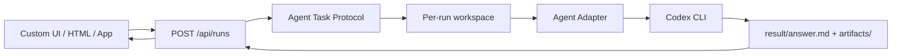
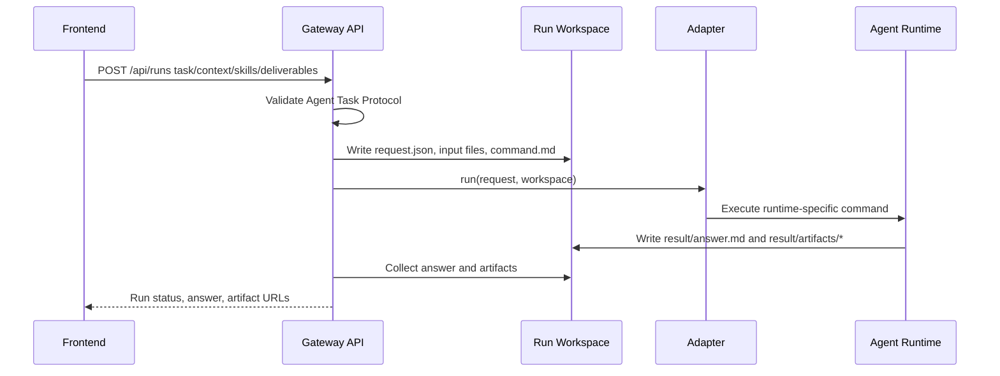
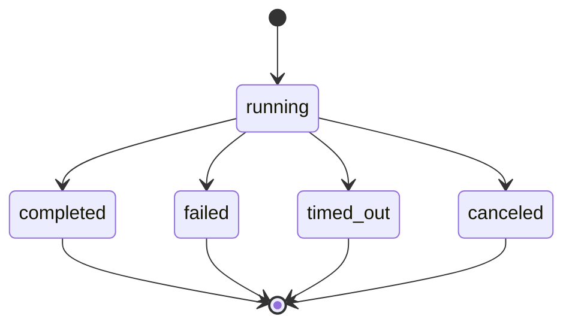

# Agent2API


Agent2API turns agent runtimes into a clean HTTP API.

## Summary

Agent2API lets a custom UI call a local agent runtime, starting with Codex CLI, without coupling that UI to Codex prompts, terminal sessions, or filesystem conventions.

The public API is intentionally agent-level:

- `task`: what the agent should accomplish.
- `context`: files, URL references, and notes supplied by the caller.
- `skills`: requested workflows or capabilities, not LLM function calls.
- `deliverables`: expected files under `result/artifacts/`.
- `options`: execution controls such as sync/async, timeout, sandbox, and web search.

The server creates a per-run workspace, writes request context to disk, renders a command for the selected adapter, runs the agent, and returns the answer plus artifact metadata.

## Motivation

Most AI APIs are model-level: they expose messages, tokens, tools, sampling options, and provider-specific response shapes. That is the wrong abstraction for a product UI that wants to ask an agent to complete work.

This project draws a harder line:

- Frontends describe work as tasks and deliverables.
- Agent runtimes decide how to execute that work.
- Adapters translate the stable task contract into Codex CLI, Claude Code, hosted agents, or future runtimes.
- Artifacts are first-class outputs, not an afterthought buried in text.

The goal is to make the API small enough for a solo developer to run locally and stable enough for other agent backends to follow.

## Design







The first adapter is `codex-cli`. The public protocol does not expose LLM messages, function calling, temperature, or provider-specific tool formats. Adapter-specific controls belong in `adapterOptions` or in adapter implementation code.

## Quick Start

Prerequisites:

- Node.js 22 or newer.
- A working local Codex CLI installation if you want live agent runs.

```bash
npm install
npm test
npm run build
npm run dev
```

The server listens on `http://127.0.0.1:3030` by default.

Health check:

```bash
curl http://127.0.0.1:3030/api/health
```

Run the bundled example:

```bash
curl -s http://127.0.0.1:3030/api/runs \
  -H 'content-type: application/json' \
  -d @examples/create-run.json
```

Run folders are written to `data/runs` unless `AGENT_RUNS_DIR` is set.

## Usage

Minimal request:

```json
{
  "apiVersion": "agent-service/v1",
  "kind": "agent.task",
  "agent": "codex",
  "task": {
    "goal": "Summarize the uploaded brief and create a short action plan.",
    "mode": "execute",
    "instructions": ["Return concise output."],
    "acceptanceCriteria": ["A markdown action plan is saved as an artifact."]
  },
  "context": {
    "files": [
      {
        "name": "brief.md",
        "mimeType": "text/markdown",
        "contentBase64": "IyBCcmllZgo="
      }
    ],
    "urls": [],
    "notes": []
  },
  "skills": [
    {
      "name": "technical-writing",
      "description": "Turn source material into concise implementation notes.",
      "required": false
    }
  ],
  "deliverables": [
    {
      "name": "action-plan",
      "type": "document",
      "description": "Markdown action plan saved under result/artifacts/.",
      "required": true,
      "mimeTypes": ["text/markdown"]
    }
  ],
  "options": {
    "mode": "sync",
    "timeoutMs": 300000,
    "sandbox": "workspace-write",
    "webSearch": false
  }
}
```

Response shape:

```json
{
  "runId": "run_mplcl8p2_ec9a2605",
  "status": "completed",
  "answer": "Agent answer text",
  "artifacts": [
    {
      "name": "action-plan.md",
      "path": "artifacts/action-plan.md",
      "mimeType": "text/markdown",
      "url": "/api/runs/run_mplcl8p2_ec9a2605/artifacts/action-plan.md"
    }
  ]
}
```

Open `examples/minimal-ui.html` for a tiny browser client. If the UI runs on another local origin, start the server with:

```bash
CORS_ORIGIN=http://127.0.0.1:5173 npm run dev
```

## Adapter Model

Adapters isolate runtime-specific behavior behind a small interface:

```ts
export interface AgentAdapter {
  capabilities(): AgentAdapterCapabilities;
  run(input: { request: AgentRunRequest; workspace: RunWorkspace }): Promise<ProcessResult>;
}
```

Current adapter:

- `codex-cli`: renders `command.md`, runs `codex exec`, and collects `result/answer.md` plus `result/artifacts/`.

Good future adapters:

- `claude-code-cli`
- `openai-agents-sdk`
- `local-shell-agent`
- `remote-agent-http`

The rule is simple: new adapters may map the request however they need, but they should not force LLM-provider concepts into the public Agent Task Protocol.

## Security Model

Default posture:

- Binds to `127.0.0.1`.
- CORS is disabled unless `CORS_ORIGIN` is set.
- Runs are isolated by workspace directory.
- URL references are recorded but not fetched by the server.
- Production dependency audit is part of CI.

Before exposing this beyond localhost, add authentication, quotas, run isolation, audit logs, artifact retention policy, and stronger process sandboxing. Avoid exposing `danger-full-access` to untrusted callers.

## Project Layout

```text
src/
  adapters/          Agent runtime adapter contracts and Codex adapter
  contract/          Zod request schema and TypeScript types
  runner/            Process runner and result collection
  server/            Fastify HTTP API
  workspace/         Per-run workspace setup
schemas/             Public JSON Schema
docs/                Protocol, API, and architecture docs
examples/            Example request and tiny HTML client
test/                Contract, adapter, workspace, runner, and readiness tests
```

## Roadmap

- Persistent run store with SQLite.
- Queue and concurrency limits.
- Cancel API and run lifecycle events.
- Server-sent events for progress streaming.
- Multipart browser uploads.
- Adapter authoring guide with a second runtime adapter.
- Skill manifest format and local skill registry.
- Optional authenticated deployment mode.

## Contributing

Read [CONTRIBUTING.md](CONTRIBUTING.md) before opening a PR. The short version:

- Keep the top-level protocol agent-level.
- Write failing tests before behavior changes.
- Keep adapter-specific knobs out of the public contract.
- Update `schemas/agent-task.schema.json` and docs when request fields change.

## License

MIT. See [LICENSE](LICENSE).
