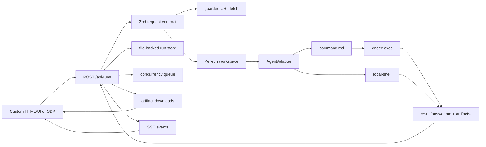

# Architecture

## Flow



## Boundaries

The public API describes agent work in agent-level terms: task, context, requested skills, expected deliverables, and run options. Codex is only the first runner adapter.

The workspace layer is the handoff contract between HTTP callers and the agent runtime. This keeps the frontend simple and makes failed runs inspectable on disk.

The adapter layer owns runtime-specific behavior. `CodexCliAdapter` delegates process execution to the Codex runner. `LocalShellAdapter` runs an explicit local command and exposes workspace paths through environment variables.

The runner layer owns command-line details, including `codex exec` arguments, stdin prompt delivery, timeout handling, and process output. Runtime stdout and stderr are forwarded into the run event stream when the adapter supports it.

The store layer persists each run record under the run workspace as `record.json`. This keeps completed run status, events, result metadata, and artifact URLs available after server restart.

The SDK layer is intentionally thin. It wraps the public HTTP API for UI clients and provides helpers for creating runs, multipart uploads, polling status, cancellation, streaming SSE events, downloading artifacts, and reading skill manifests.

## Adapter Interface

```ts
export interface AgentAdapter {
  capabilities(): AgentAdapterCapabilities;
  run(input: {
    request: AgentRunRequest;
    workspace: RunWorkspace;
    events?: ProcessEvents;
    signal?: AbortSignal;
  }): Promise<ProcessResult>;
}
```

This interface is deliberately smaller than the public protocol. Adapters can do their own prompt rendering, runtime setup, or external service calls as long as they honor the workspace output contract.

## URL Fetching

Server-side URL fetching is intentionally guarded. Agent2API accepts only HTTP and HTTPS URLs, blocks private and loopback hosts unless they are explicitly allowlisted, and enforces a byte limit before writing fetched content into `input/files/url-<n>.txt`.

## Production Hardening Checklist

- Configure `apiKey` for every non-local deployment.
- Configure `maxConcurrentRuns`, request body limits, and disk quotas.
- Configure `retentionMs` for local run cleanup.
- Configure `auditLogPath` and ship logs to a central store.
- Run agents inside a stronger OS sandbox or container.
- Keep private URL hosts allowlisted explicitly.
- Store artifacts in object storage if local disk is not enough.
- Add per-user authorization if multiple users share one service.
