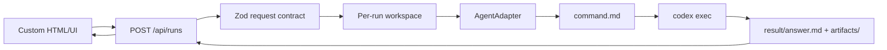

# Architecture

## Flow



## Boundaries

The public API describes agent work in agent-level terms: task, context, requested skills, expected deliverables, and run options. Codex is only the first runner adapter.

The workspace layer is the handoff contract between HTTP callers and the agent runtime. This keeps the frontend simple and makes failed runs inspectable on disk.

The adapter layer owns runtime-specific behavior. `CodexCliAdapter` is the first implementation and delegates process execution to the runner layer.

The runner layer owns command-line details, including `codex exec` arguments, stdin prompt delivery, timeout handling, and process output.

## Adapter Interface

```ts
export interface AgentAdapter {
  capabilities(): AgentAdapterCapabilities;
  run(input: { request: AgentRunRequest; workspace: RunWorkspace }): Promise<ProcessResult>;
}
```

This interface is deliberately smaller than the public protocol. Adapters can do their own prompt rendering, runtime setup, or external service calls as long as they honor the workspace output contract.

## Why URL References Are Not Fetched In V1

URL fetching needs SSRF rules, auth handling, content limits, robots/copyright policy, and caching. V1 stores URL references and, when `webSearch` is true, allows Codex to use its own web-search capability. Server-side fetch can be added later as a separate, testable adapter.

## Production Hardening Checklist

- Add API keys or session auth.
- Add per-user run quotas, file size limits, and total disk caps.
- Move run records from memory to SQLite/Postgres.
- Add a queue and concurrency limits.
- Run agents inside a stronger OS sandbox or container.
- Add URL fetch allowlists before server-side crawling.
- Store artifacts in object storage if runs must survive local cleanup.
- Add structured audit logs with redaction.
